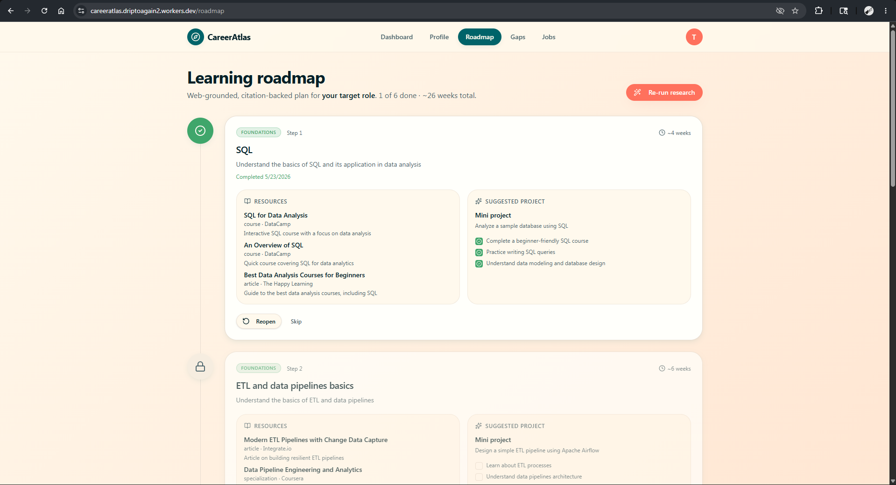
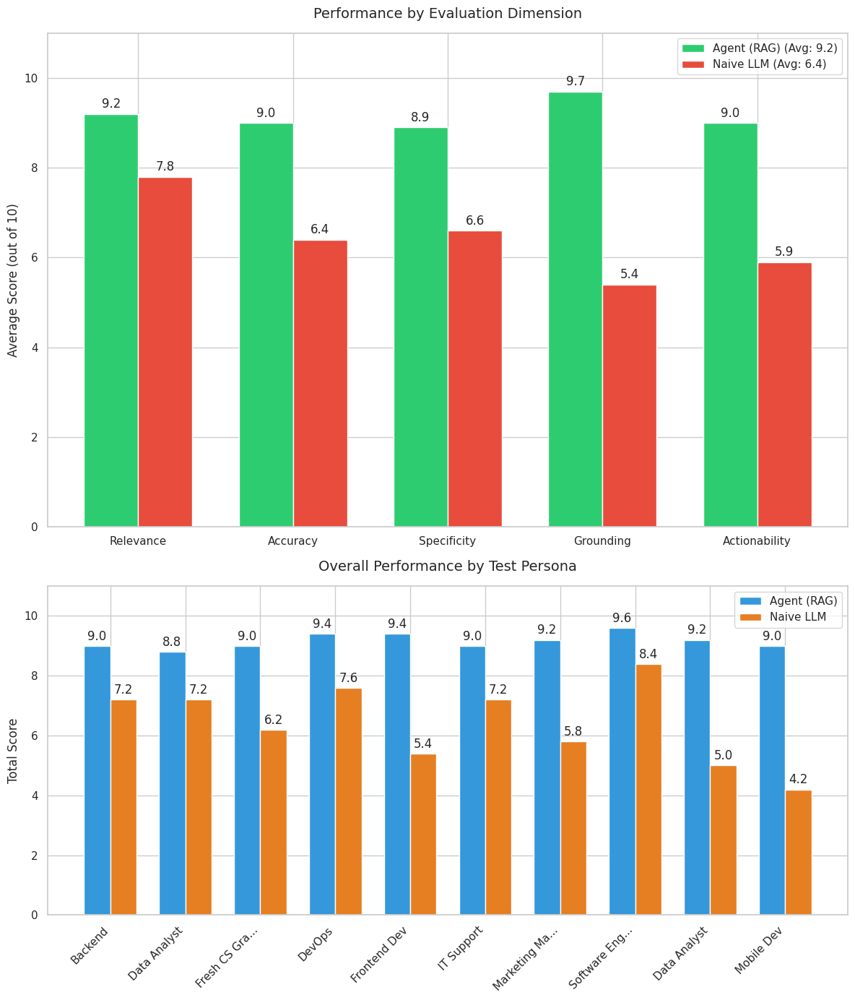
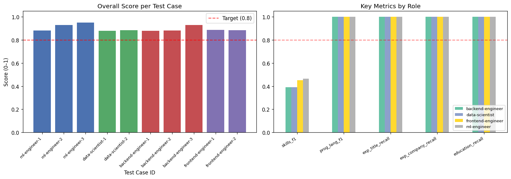
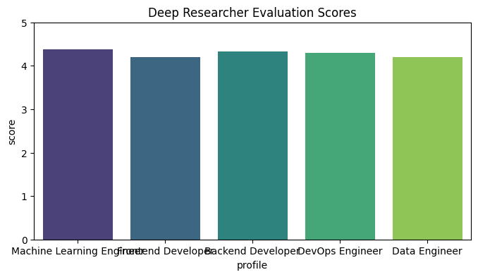
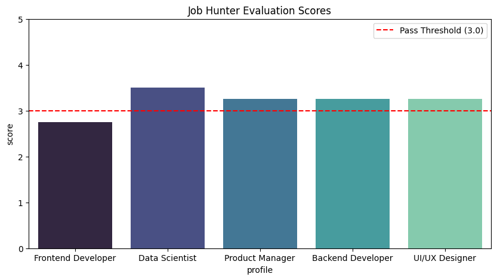

# CareerAtlas

CareerAtlas is an AI-powered personal career planner that parses your resume, identifies skill gaps, constructs a week-by-week learning roadmap, and matches you with tailored jobs in real time.

Pipeline: **profile extraction & switching → gap analysis → learning roadmap → job matches**.

## About The Project

CareerAtlas is designed as a senior career advisor for early-career developers. Instead of generic, one-size-fits-all roadmaps, CareerAtlas connects to your actual professional history.
Through a multi-agent system, the app identifies exactly what skill gaps exist between your current profile and your target career role, retrieves online tutorials/courses to bridge those gaps, and ranks real job postings by skill compatibility.

### Links
[Working Web App](https://careeratlas.driptoagain2.workers.dev)

[Deep Wiki documentation](https://deepwiki.com/driptobhattacharyya/Career-Atlas)

## Key Features

- **Multi-Resume Support & Profile Selector:** The onboarding process queries all your previously extracted profiles in Supabase, allowing you to select and switch your active profile dynamically or choose to upload/type a new one.
- **Manual Profile Input:** Supports creating or modifying your profile manually with a custom form UI, avoiding forcing you to upload a PDF.
- **GitHub Profile Analysis (evidence-bound):** Connect GitHub via OAuth to infer skills, projects, and coding behavior from your actual repositories (manifest-first file reads + language %s + owner-authored commit stats, forks excluded). Every inferred skill is bound to concrete evidence (a quoted file path or language stat) with a confidence tier; strong matches auto-confirm and the rest are surfaced for review. Only **confirmed** GitHub skills feed your profile, gap analysis, and job matching — quarantined guesses never masquerade as resume truth.
- **Dynamic Skill Gap Analysis (any role):** Semantic taxonomy matching (Qdrant vector retrieval + BM25 + Jina Rerank, with sigmoid-normalized relevance) comparing your skills against a target role to identify critical gaps. Ships with 8 curated tech-role taxonomies; **any other role — unlisted tech or non-technical (marketing, nursing, finance) — gets an AI-generated skill taxonomy on the fly** (labeled experimental), so the role picker is free-text, not a fixed list.
- **Curated Learning Roadmaps:** Builds week-by-week, resource-linked pathways generated by web-grounded research agents.
- **Ranked Job Matching:** Real-time job indexing powered by Adzuna, ranked using skill overlap, education, experience, and semantic fit.
- **Fault-Tolerant API Rotation:** Features automatic Google API key rotation (supporting 1 to 4 rotatable keys) combined with exponential backoff retries for robust Gemini operations.
- **Self-Hosted LLM Support (optional):** Run all generation on your own hardware via any OpenAI-compatible server (llama.cpp, Ollama, vLLM). Embeddings & rerank run locally via the bundled embed-rerank sidecar (Nemotron-3-Embed + Jina-reranker-v3). No external LLM APIs required.
- **Custom Theme Engine:** Supports visual personalization (default, sunset, and ocean) using custom OKLCH color palettes.
- **Navigation Guarding:** Secure frontend routing that checks for profile completion and renders a friendly `<NoProfileView />` screen across dashboard, roadmap, and jobs pages if a user has not onboarded.

## Tech Stack

- **Frontend:** React 19, Vite, TanStack Router & Query, Tailwind CSS, Lucide icons, Motion (Framer).
- **Backend:** FastAPI, LangChain, Python 3.12, Uvicorn.
- **Database & Storage:** Supabase (Postgres & Auth), Supabase Storage for resumes.
- **AI & RAG:** 
  - *Managed:* Gemini 2.5 Flash (embeddings for RAG, with 1–4 key rotation + backoff), Groq Llama 3.3 70B (GitHub analysis, deep researcher), Tavily (search), Jina (rerank)
  - *Self-hosted (optional):* Any OpenAI-compatible server for generation (llama.cpp, Ollama, vLLM); local embed-rerank sidecar (Nemotron-3-Embed 2048-dim + Jina-reranker-v3) on GPU; Qdrant vector DB
- **Deployment:** Backend on **AWS Lambda**, frontend on **Cloudflare Workers**, both auto-deployed from `prod` via GitHub Actions. See [`DEPLOYMENT_HANDOFF.md`](DEPLOYMENT_HANDOFF.md).
- **Local / Self-Hosted:** Docker Compose stack (frontend, backend, Qdrant, embed-rerank). See [Self-Hosting](#self-hosting--local-development) below.

## Quick Start

### Option A: One-Command Local Stack (Recommended for Self-Hosting)

```bash
# 1. Start Supabase locally (separate terminal)
supabase start

# 2. Start the full Career-Atlas stack
docker compose up --build
```

This brings up:
- **Frontend** → http://localhost:5173 (Vite dev server with SSR)
- **Backend** → http://localhost:8000 (FastAPI)
- **Qdrant** → http://localhost:6333 (vector DB)
- **Embed-Rerank** → http://localhost:7997 (Nemotron embed + Jina rerank)

**Prerequisites:** Docker, Docker Compose, Supabase CLI, NVIDIA GPU (for embed-rerank; CPU fallback works but is slow).

Configure secrets in `backend/.env` (copy from `backend/.env.example`). The compose file injects container-internal URLs for Qdrant/embed-rerank and reaches Supabase + optional host LLM via `host.docker.internal`.

---

### Option B: Manual Local Development (Backend + Frontend Separately)

#### 1. Backend Setup

```bash
cd backend
cp .env.example .env        # then fill in your API keys
uv sync
# Ingest the Qdrant skill taxonomy (required for gap analysis)
uv run python scripts/ingest_taxonomy.py --wipe
# Start the API server
uv run uvicorn app.main:app --reload
```

The backend server will run at `http://localhost:8000`.

#### 2. Frontend Setup

```bash
cd frontend
cp .env.example .env        # then fill in your VITE_ variables
bun install                 # or npm install
bun dev                     # or npm run dev
```

The frontend application will run at `http://localhost:8080`.

---

## Self-Hosting & Local Development

### Docker Compose Stack (Single Machine)

The `docker-compose.yml` defines a complete local stack:

| Service | Port | Purpose |
|---------|------|---------|
| `frontend` | 5173 | TanStack Start dev server (SSR + HMR) |
| `backend` | 8000 | FastAPI (proxies to container port 8080) |
| `qdrant` | 6333 | Vector database for skill taxonomy |
| `embed-rerank` | 7997 | Nemotron-3-Embed (GPU) + Jina-reranker-v3 (CPU) |

**GPU Requirements:** The embed-rerank sidecar uses an NVIDIA GPU (validated on 4 GB GTX 1650). The reranker intentionally stays on CPU to leave VRAM for a co-resident LLM. Set `HOST_MODELS_DIR` to a local Hugging Face cache to avoid re-downloads.

### Self-Hosted LLM Integration (Generation Only)

The backend routes **all generation** (resume extraction, gap analysis, roadmap, deep research, job reasoning) to a self-hosted LLM when `USE_SELF_HOSTED_LLM=true`.

**Contract:** Point `SELF_HOSTED_LLM_BASE_URL` at any OpenAI-compatible chat completions endpoint.

```bash
# Example: llama.cpp server on host
llama-server -m model.gguf --port 9292 --ctx-size 8192 --host 0.0.0.0

# backend/.env
USE_SELF_HOSTED_LLM=true
SELF_HOSTED_LLM_BASE_URL=http://host.docker.internal:9292/v1
SELF_HOSTED_LLM_MODEL=local-model
SELF_HOSTED_LLM_API_KEY=sk-no-key-required
```

**Why the LLM lives on the host (not in Docker):**
- **GPU sharing:** The embed-rerank sidecar already occupies the GPU. Running the LLM on the host lets you manage VRAM allocation (e.g., `--gpu-layers`, `--split-mode`) per workload.
- **Model swapping:** Hot-swap GGUFs without rebuilding containers.
- **Hardware-specific tuning:** llama.cpp/llama-server flags (flash-attn, mlock, tensor split) are hardware-dependent.

**Optional: Add an LLM container** (if you have ample VRAM, e.g., 24 GB+):
```yaml
# docker-compose.yml addition
llm:
  image: ghcr.io/ggerganov/llama.cpp:server-cuda
  command: ["-m", "/models/model.gguf", "--port", "8080", "--host", "0.0.0.0", "--ctx-size", "8192"]
  volumes:
    - ./models:/models
  deploy:
    resources:
      reservations:
        devices:
          - driver: nvidia
            count: 1
            capabilities: [gpu]
```
Then set `SELF_HOSTED_LLM_BASE_URL=http://llm:8080/v1` in the backend environment. **Caveat:** GPU memory contention with embed-rerank; monitor with `nvidia-smi`.

### Production Hardening (Three Substitution Points)

When moving from docker-compose to a hardened self-hosted deployment, swap these three components:

| Component | Dev (docker-compose) | Production Swap |
|-----------|---------------------|-----------------|
| **Vector DB** | Qdrant local (`qdrant:6333`) | **Qdrant Cloud** (free tier) or managed Qdrant — set `QDRANT_URL` + `QDRANT_API_KEY` |
| **Embed/Rerank** | Local sidecar (`embed-rerank:7997`, GPU) | **BYO embed/rerank endpoint** — any OpenAI-compatible `/v1/embeddings` + Jina-compatible `/rerank`; set `EMBEDDINGS_BASE_URL`, `RERANKER_BASE_URL`, `EMBEDDINGS_DIM` (must match embedder; re-ingest on change) |
| **LLM (generation)** | Host llama.cpp (`host.docker.internal:9292`) | **Managed LLM** (Groq, OpenRouter, Together, etc.) or **dedicated vLLM/Ollama VM** — set `USE_SELF_HOSTED_LLM=true` + `SELF_HOSTED_LLM_BASE_URL` |

**Embedding dimension coupling:** `EMBEDDINGS_DIM` in backend config **must** match your embedder output. Changing it requires re-ingesting the taxonomy:
```bash
uv run python scripts/ingest_taxonomy.py --wipe
```

### Supabase

Local dev uses `supabase start` (separate CLI-managed stack). For self-hosted production, you can:
- Keep Supabase (managed) — simplest
- Self-host Supabase (Docker) — more ops burden
- Replace with raw Postgres + GoTrue + PostgREST — not recommended

The backend only needs `SUPABASE_URL`, `SUPABASE_PUBLISHABLE_KEY`, `SUPABASE_SECRET_KEY` (service role).

## Methodology

CareerAtlas employs a specialized **Multi-Agent Architecture** to execute tasks:

1. **Extraction & Matching Agents:** Parse profile contents and compute similarity metrics on indexed jobs.
2. **Gap Analysis & Research Agents:** Query vector stores for relevant skill nodes and plan roadmap phases using Tavily search.
3. **API key Rotator:** Keeps operations running by cycling API keys on failures, shifting from primary to secondary keys transparently.

## Walkthrough

Here is a visual walkthrough of the platform:

### 1. Landing Page


### 2. User Dashboard


### 3. Profile Selector & Extraction


### 4. Work Experience Extraction


### 5. Personal Projects Extraction


### 6. Career Roadmap



### 7. Skill Gap Analysis


### 8. Job Finder


## Evaluation & Benchmarks

Core agents were evaluated using **LLM-as-a-Judge** frameworks to guarantee output quality:

### 1. Gap Analysis Agent

Comparing RAG-augmented extraction (Qdrant + Jina Rerank) against Naive LLM queries proved that our RAG pipeline yields far more context-specific skill suggestions.


### 2. Resume Extraction Agent

Field-level metric testing showed high precision and recall on parsed experiences and skills.


### 3. Deep Researcher Agent

A LangGraph search planner evaluated on curriculum structures verified relevant online roadmap assets.


### 4. Job Hunter Agent

Validated location and role relevance filters on Adzuna results.


## Contributors

- **Tanush Tambe** - Resume Extractor, Job Finder, Evaluation Notebooks
- **Dripto Bhattacharyya** - Deep Researcher, Evaluation, Deployment
- **Sidhaarth Shree** - Gap Analysis Agent, Evaluation
- **G Hamsini** - Contributor
- **Shivanshu Gupta** - Contributor